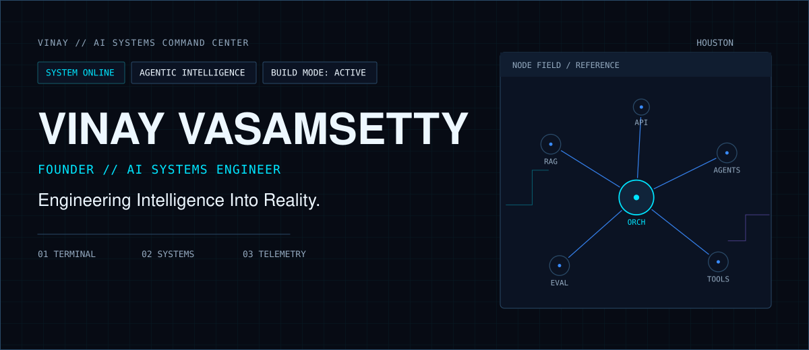
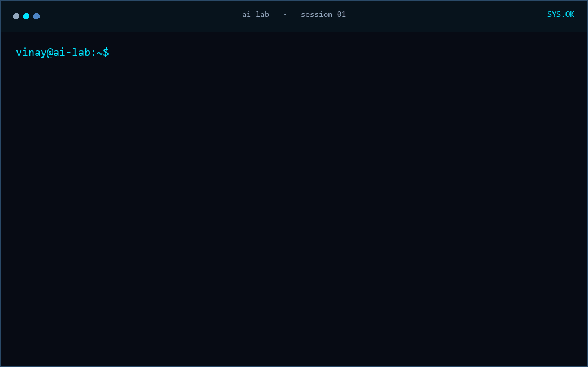
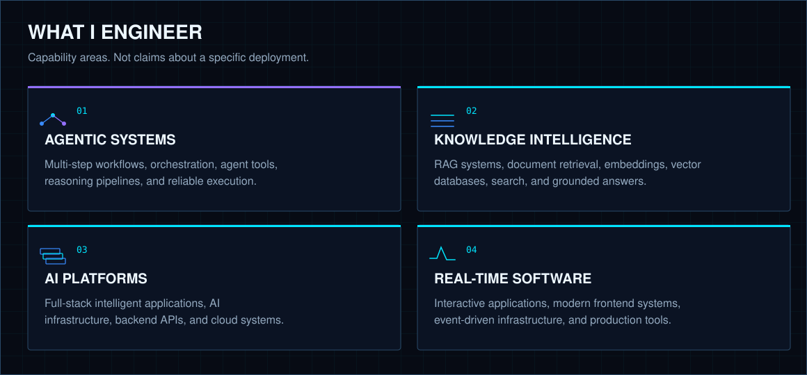
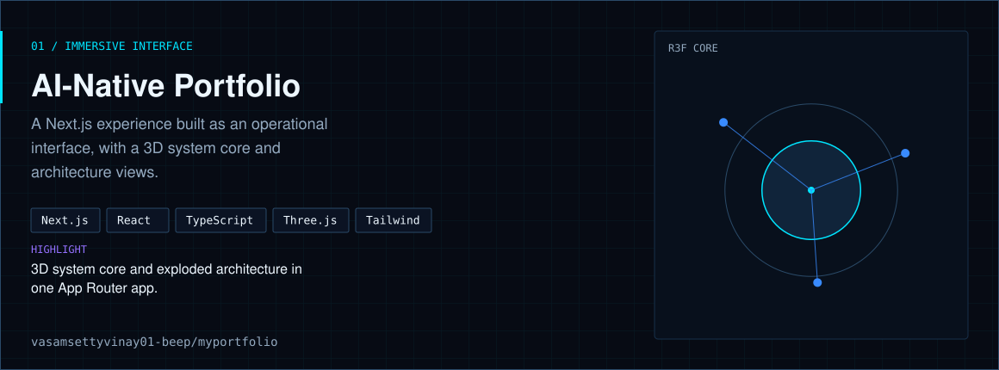
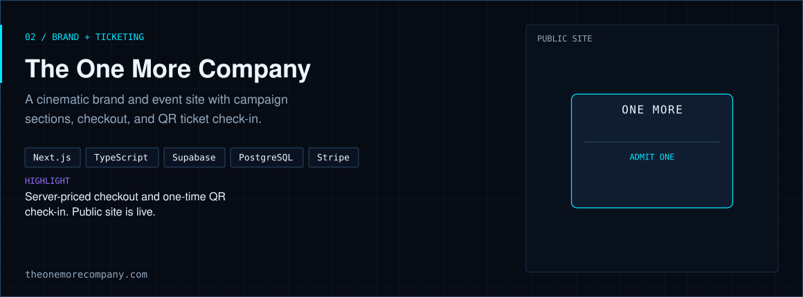
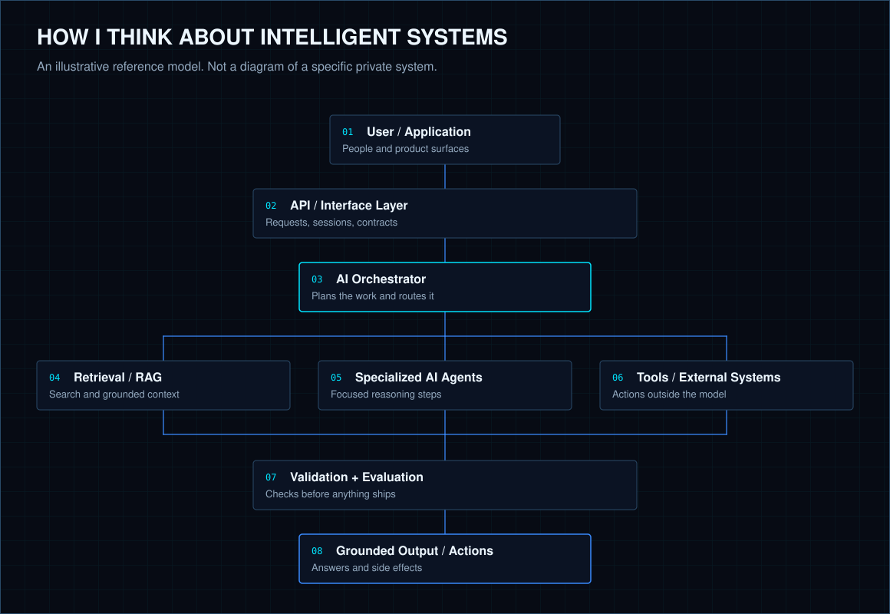
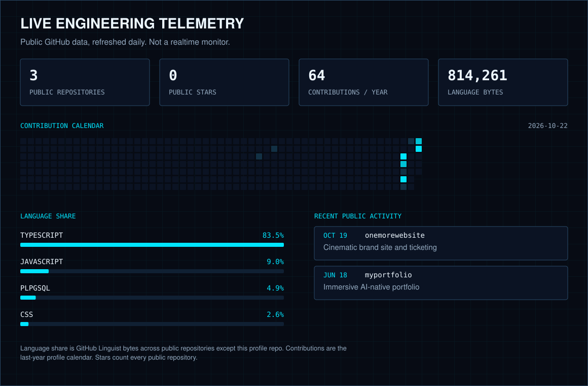
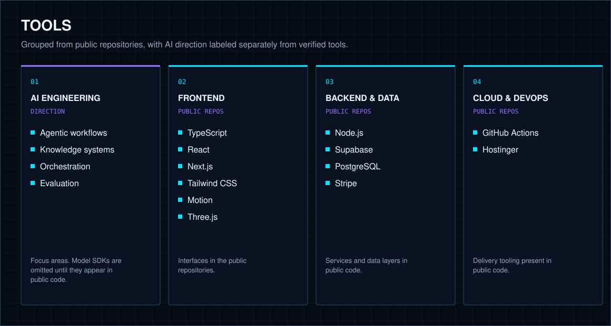
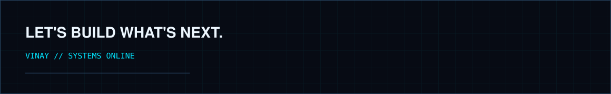

<picture>
  <source media="(max-width: 720px)" srcset="./assets/hero-mobile.svg">
  
</picture>

Founder and AI systems engineer. I build software around agentic workflows, knowledge systems, and the product layers that make them usable.

[Projects](#selected-engineering) · [Architecture](#how-i-think-about-intelligent-systems) · [Activity](#live-engineering-telemetry) · [Connect](#lets-build-whats-next)

## Initializing AI Systems

<picture>
  <source media="(max-width: 720px) and (prefers-reduced-motion: reduce)" srcset="./assets/terminal-mobile.svg">
  <source media="(prefers-reduced-motion: reduce)" srcset="./assets/terminal.svg">
  <source media="(max-width: 720px)" srcset="./assets/terminal-mobile.gif">
  
</picture>

<details>
<summary>Terminal transcript</summary>

```text
vinay@ai-lab:~$ whoami
Vinay Vasamsetty
Founder & AI Systems Engineer

vinay@ai-lab:~$ focus
> Agentic AI Systems
> Retrieval-Augmented Generation
> AI Infrastructure
> Intelligent Automation
> Full-Stack Engineering

vinay@ai-lab:~$ mission
Engineering intelligent systems that transform
complex problems into practical software.

vinay@ai-lab:~$ status
SYSTEMS ONLINE
READY TO BUILD
```

</details>

## What I Engineer

<picture>
  <source media="(max-width: 720px)" srcset="./assets/engineer-mobile.svg">
  
</picture>

## Selected Engineering

<a href="https://github.com/vasamsettyvinay01-beep/myportfolio">
  <picture>
    <source media="(max-width: 720px)" srcset="./assets/projects/myportfolio-mobile.svg">
    
  </picture>
</a>

[myportfolio](https://github.com/vasamsettyvinay01-beep/myportfolio) — immersive operational interface with a 3D system core. No public deployment URL is listed on the repository.

<a href="https://theonemorecompany.com">
  <picture>
    <source media="(max-width: 720px)" srcset="./assets/projects/onemorewebsite-mobile.svg">
    
  </picture>
</a>

[The One More Company](https://theonemorecompany.com) — cinematic brand site and ticketing flow. [Repository](https://github.com/vasamsettyvinay01-beep/onemorewebsite).

## How I Think About Intelligent Systems

<picture>
  <source media="(max-width: 720px)" srcset="./assets/architecture-mobile.svg">
  
</picture>

## Live Engineering Telemetry

<picture>
  <source media="(max-width: 720px)" srcset="./assets/activity/telemetry-mobile.svg">
  
</picture>

Language share is GitHub Linguist bytes summed across public repositories. Contributions are the last-year profile calendar. Stars are stargazer counts on those public repositories. Figures are regenerated daily. This is not a realtime monitor.

## Tools

<picture>
  <source media="(max-width: 720px)" srcset="./assets/skills-mobile.svg">
  
</picture>

## Let's Build What's Next.

Exploring intelligent systems, ambitious engineering, and software that turns complex ideas into reality.

[GitHub](https://github.com/vasamsettyvinay01-beep) · [LinkedIn](https://www.linkedin.com/in/vinayvasamsetty/) · [Portfolio source](https://github.com/vasamsettyvinay01-beep/myportfolio)

<picture>
  <source media="(max-width: 720px)" srcset="./assets/footer-mobile.svg">
  
</picture>
